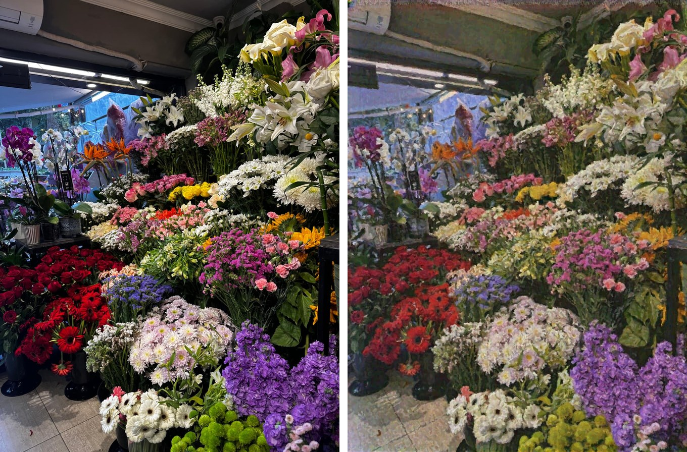
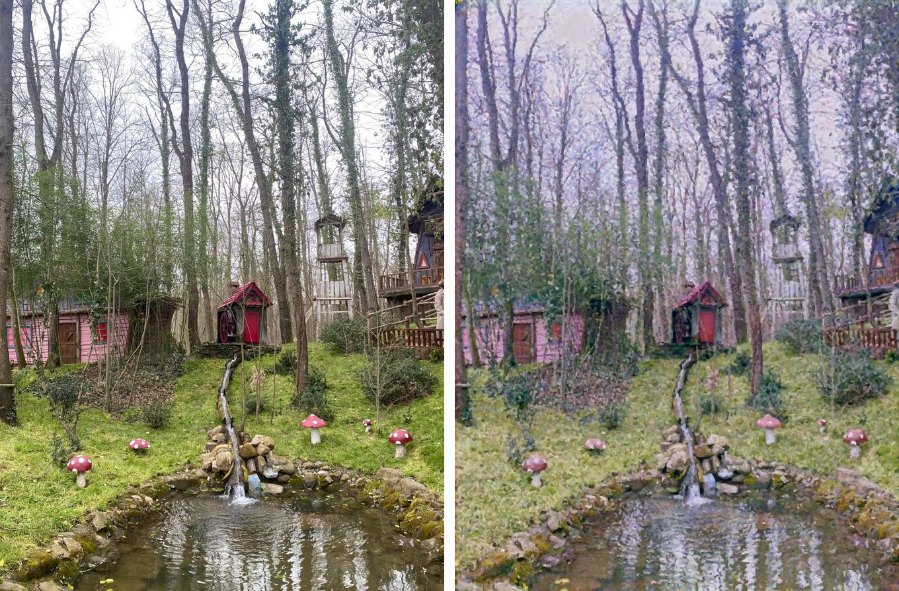
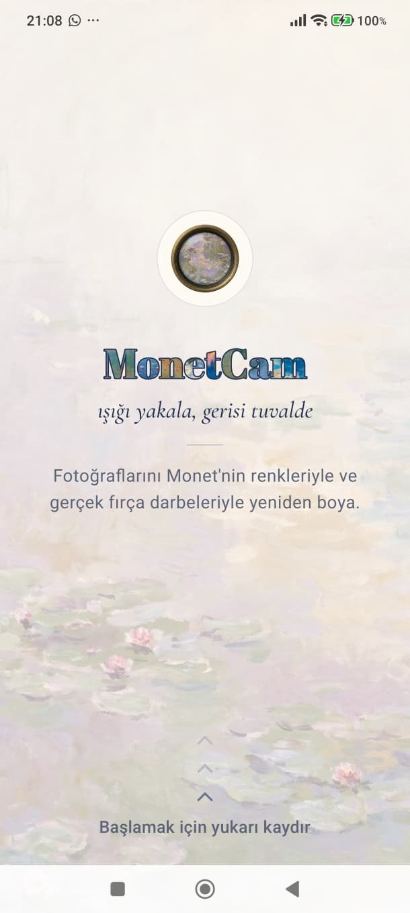
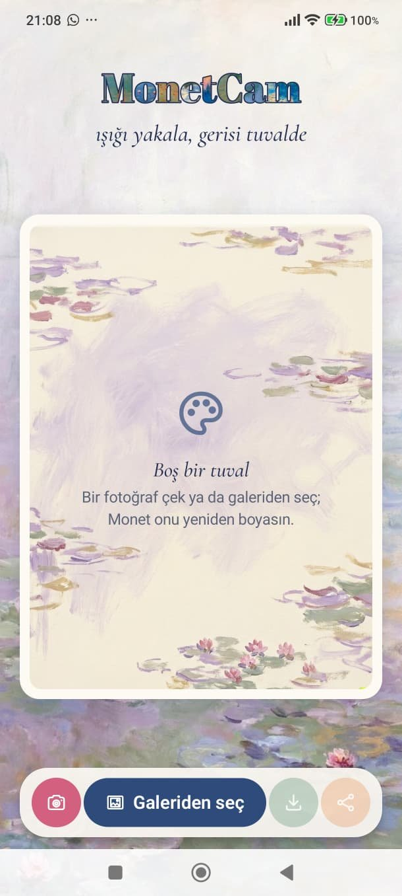
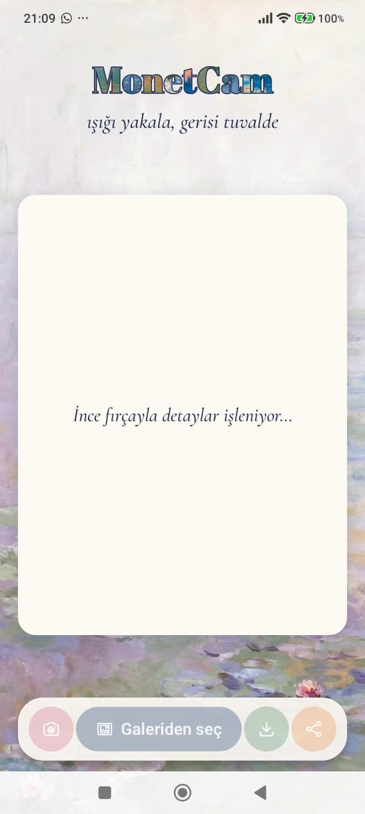
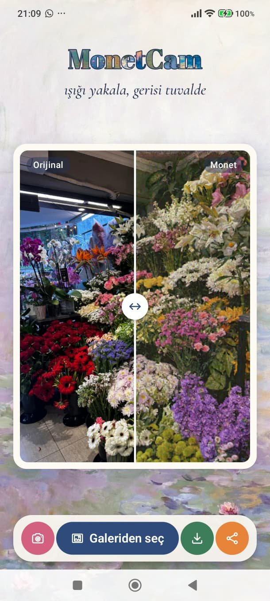

# MonetCam

MonetCam is an Android app that repaints a photo in the style of Claude Monet, fully on-device. A CycleGAN generator fine-tuned on Monet's paintings produces the color and light, and a stroke-based renderer then repaints that image on a blank canvas with curved brush strokes, so the result has actual paint texture instead of a filtered look.

This repo holds both sides of the project: the PyTorch training and export code (root folder) and the Android app (`android/`).

<p align="center">
  
  
</p>
<p align="center"><sub>Left: original photo, right: MonetCam output (both generated on the phone).</sub></p>

## Screenshots

<p align="center">
  
  
  
  
</p>
<p align="center"><sub>Welcome screen (swipe up to start) · empty canvas · processing · before/after slider</sub></p>

## Pipeline

```
photo ─► decode at ~1000 px short side ─► center crop 3:4 ─► 672×896
      ─► CycleGAN generator (LiteRT, GPU fp32, 20 segments)
      ─► stroke renderer: radius 4 → 2 → 1 px, ~900k strokes, 8 threads
      ─► 672×896 painting
```

### 1. CycleGAN

The generator is the ResnetGenerator from the original CycleGAN paper: 7×7 stem, two stride-2 downsampling convs, 9 residual blocks at 1/4 resolution, two transposed-conv upsampling steps and a 7×7 head with tanh (11.4M parameters, ~473 GMACs at 896×672). Instance norm is used throughout.

Training (`train_cyclegan.py`) starts from the authors' public `style_monet` weights and fine-tunes on the monet2photo dataset:

| | |
|---|---|
| Generators | G (photo → Monet) from pretrained weights, F (Monet → photo) from scratch |
| Discriminators | 70×70 PatchGAN, LSGAN loss, 50-image history pool |
| Optimizer | Adam (β1 = 0.5); lr 5e-5 for G, 2e-4 for F and the discriminators |
| Loss weights | cycle 5.0, identity 0.5 (paper: 10 and 5, lowered for a bolder transfer) |
| Schedule | 20k steps on 256×256 crops, G frozen for the first 1.5k steps so the new discriminators can catch up |

Training ran on Kaggle GPUs. Before CycleGAN I tried Johnson-style fast style transfer (`model.py`, `losses.py`, `train.py`) with VGG perceptual and Gram losses. Instance norm there produced recurring blob artifacts, and switching to batch norm traded them for a repetitive texture. Neither looked like a painting, which is why the project moved to CycleGAN plus an explicit painting step.

### 2. Stroke renderer

The CycleGAN output is a good color reference but still looks like a filtered photo. The renderer (`paint.py`, ported to Kotlin in `Painter.kt`) follows Hertzmann's *Painterly Rendering with Curved Brush Strokes of Multiple Sizes*:

- **Layers:** three layers with brush radii 4, 2 and 1 px. Each layer works on a Gaussian-blurred reference with σ = R/2, so large brushes ignore fine detail.
- **Where strokes start:** a grid with spacing ≈ R. A stroke starts in a cell only where the mean color difference between the canvas and the reference is above 18. The first layer covers the whole canvas.
- **Stroke shape:** strokes are 2 to 14 control points long and follow the direction perpendicular to the luminance gradient, i.e. along edges. Curvature is smoothed with a factor of 0.7.
- **When a stroke stops:** as soon as the canvas color at the next point is already closer to the reference than the stroke color.
- **Color:** each stroke color gets ±8 random jitter per channel.

A typical photo needs around 900k strokes. On the phone the stroke paths are computed first, then the canvas is split into 24 horizontal bands that are rasterized in parallel on 8 threads. Strokes are binned into every band they touch and drawn in the original order, so the parallel result is identical to a single-threaded one.

## Running it on a phone GPU

Getting a 11M-parameter CycleGAN to run at 896×672 on a mid-range phone took most of the engineering. The export path is PyTorch → [litert-torch](https://github.com/google-ai-edge/litert-torch) → LiteRT `CompiledModel` with the GPU accelerator.

**Making the graph GPU compatible** (`export_cyclegan_gpu.py`)
- `nn.ReflectionPad2d` was lowered to `GATHER_ND` with integer index math, which the GPU delegate can't compile. It is rewritten as slices and concatenations.
- `ConvTranspose2d` is not supported by the converter. Each one is replaced by a conv with four 2×2 sub-kernels (one per output phase). Using `pixel_shuffle` to interleave the phases produced 6-D reshapes and transposes, so the interleaving is done with 4-D reshapes in NHWC instead. The result matches the original layer to 1e-6.
- I/O is NHWC (`to_channel_last_io`), which cut the number of `TRANSPOSE` ops in the graph from 111 to 2.

**Precision**
- In fp16 the output came out white. Activations before the instance norms reach about 3·10⁴ and their squares overflow fp16's 65504 limit.
- The export folds a 1/16 scale into every conv that feeds an instance norm (IN is scale invariant, so with ε scaled accordingly the math is unchanged). Variance is computed on values normalized by the per-channel max.
- That fixed the overflow in simulation, but on the Adreno GPU fp16 still diverged (mean error 0.40), so the app runs the GPU in fp32.

**Self-test and fallback**
- On startup the model runs once on a fixed sinusoidal test pattern. 192 sampled output values are compared against reference values computed on the desktop.
- If the mean error is above 0.05, the app falls back to the CPU (XNNPACK). This catches silent GPU precision problems instead of showing the user a broken image.

**Keeping the UI responsive**
- A single 6-second GPU call blocks HWUI, which also needs the GPU, so the screen froze for the whole inference.
- The model is exported as one `.tflite` with 20 signatures (encoder, the two halves of each of the 9 residual blocks, two decoder stages). The app runs them back to back with a short pause between them so the UI can render frames.
- The loading screen shows the real stage instead of a spinner.

## Performance

Redmi Note 13 Pro 5G (Snapdragon 7s Gen 2, Adreno 710), 896×672:

| Stage | Time |
|---|---|
| CycleGAN on CPU (XNNPACK, fp32) | ~50 s |
| CycleGAN on GPU (fp32, 20 segments) | ~6 s |
| Stroke renderer, 8 threads | 7–11 s |
| Model compile + self-test at startup | ~14 s, runs in the background on the welcome screen |

## Project layout

| Path | |
|---|---|
| `cyclegan.py` | Generator definition and checkpoint loading |
| `train_cyclegan.py` | Fine-tuning (G, F, two PatchGAN discriminators) |
| `try_cyclegan.py` | Run the generator on a single image |
| `paint.py` | Reference implementation of the stroke renderer |
| `export_cyclegan_gpu.py` | GPU-friendly layer rewrites and single-model export |
| `export_cyclegan_segments.py` | 20-signature export used by the app |
| `export_cyclegan_chunks.py` | 88-signature variant (channel-split, not used in the app) |
| `model.py`, `losses.py`, `train.py`, `stylize.py` | Earlier fast style transfer experiments |
| `android/` | Kotlin + Jetpack Compose app, LiteRT 2.3 |

## Getting started

```bash
python -m venv venv
venv\Scripts\activate                     # Windows
pip install torch torchvision --index-url https://download.pytorch.org/whl/cu126
pip install -r requirements.txt

python try_cyclegan.py images/photo.jpg   # needs checkpoints/cyclegan/G_bold_final.pth
python export_cyclegan_segments.py        # writes monet_cyclegan_seg_896x672.tflite
```

Copy the `.tflite` file to `android/app/src/main/assets/`, open `android/` in Android Studio and run it (minSdk 28). Checkpoints and datasets are not in the repo because of their size.

## Credits

- **CycleGAN:** Zhu, Park, Isola, Efros. *Unpaired Image-to-Image Translation using Cycle-Consistent Adversarial Networks*, ICCV 2017. Pretrained `style_monet` weights from the official repo.
- **Stroke renderer:** Hertzmann. *Painterly Rendering with Curved Brush Strokes of Multiple Sizes*, SIGGRAPH 1998.
- **Logo:** the letters are filled with crops of Monet paintings (public domain, Wikimedia Commons).
- **App images:** the background, empty canvas and app icon were generated with Higgsfield (Nano Banana Pro).
- **Fonts:** Abril Fatface and Cormorant Garamond (OFL), Special Elite (Apache 2.0). License files are in `android/app/src/main/assets/licenses/`.
