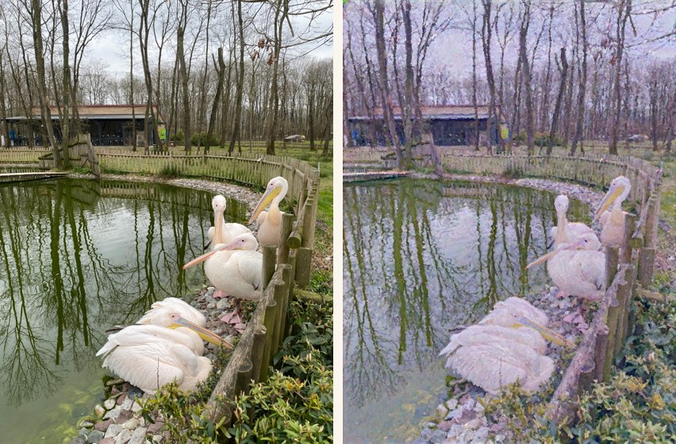
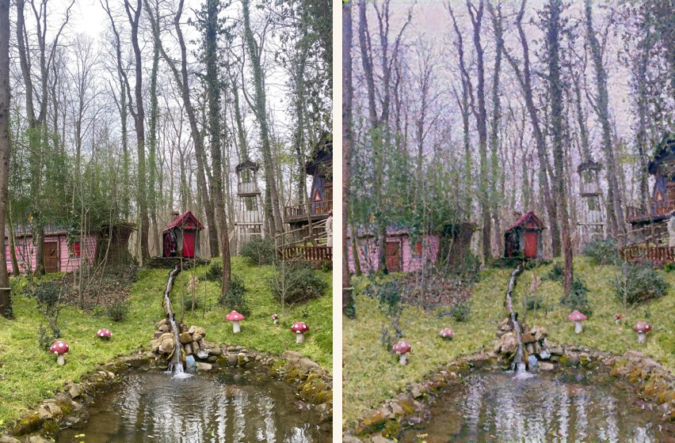

# MonetCam

An Android app that turns a photo you take (or pick from your gallery) into a Claude Monet style painting. Everything runs on the phone, no internet needed.

The repo has two parts: the Python side where the model is trained and exported (this folder), and the app itself (`android/`).




*Left: original photo. Right: MonetCam.*

## How it works

1. **CycleGAN** – the photo first goes through a CycleGAN trained on Monet paintings. This gives the colors and the light.
2. **Brush strokes** – the result is then repainted on an empty canvas with real brush strokes (Hertzmann 1998), going from a thick brush to a thin one. Strokes curve along the edges of the image.

I started with fast style transfer (Johnson et al.) but it kept producing blotchy artifacts and never really looked like a painting, so I switched to CycleGAN.

## Files

| File | What it does |
|---|---|
| `cyclegan.py` | CycleGAN generator (same ResnetGenerator as the official code) |
| `train_cyclegan.py` | Fine-tuning on monet2photo (ran on Kaggle) |
| `try_cyclegan.py` | Try a single photo on your computer |
| `paint.py` | Python version of the brush stroke painter |
| `export_cyclegan_gpu.py` | Export to tflite so it runs on the phone GPU |
| `export_cyclegan_segments.py` | Same, but split into 20 parts (this is what the app uses) |
| `model.py`, `losses.py`, `train.py`, `stylize.py` | Older fast style transfer experiments |
| `android/` | The Android app (Kotlin, Jetpack Compose, LiteRT) |

## Setup (Python)

```bash
python -m venv venv
venv\Scripts\activate            # Windows
pip install torch torchvision --index-url https://download.pytorch.org/whl/cu126
pip install -r requirements.txt
```

To try a photo:

```bash
python try_cyclegan.py images/photo.jpg
```

Weights (`checkpoints/`) and datasets are not in the repo because of their size.

## Training

- **Data:** the monet2photo dataset on Kaggle.
- **Starting point:** the `style_monet` weights released by the CycleGAN authors.
- **Fine-tuning:** `train_cyclegan.py` starts from those weights.

On Kaggle, run the notebook with **Save & Run All**. Outputs from an interactive session get lost.

## Exporting to the phone

```bash
python export_cyclegan_segments.py
```

Copy the resulting `monet_cyclegan_seg_896x672.tflite` into `android/app/src/main/assets/`. Things I had to change along the way:

- **Unsupported ops:** ReflectionPad, InstanceNorm and ConvTranspose are rewritten with ops the GPU supports.
- **Precision:** in half precision (fp16) the values overflowed and the output came out white or black, so the app runs the GPU in fp32.
- **Splitting:** as a single model the GPU was busy for a few seconds and the screen froze. Splitting it into 20 parts fixed that.

## Android app

Open the `android/` folder in Android Studio and run it (minSdk 28).

- **Start:** swipe up on the welcome screen.
- **Photo:** take one with the camera or pick from the gallery.
- **Result:** compare with the original using the before/after slider, save to the gallery or share.
- **Model check:** on startup the GPU is checked with a known test pattern. If the result doesn't match, the model runs on the CPU instead.

On a Redmi Note 13 Pro 5G a photo takes about 15 seconds: ~6 s for the model and ~8 s for the brush strokes.

## Credits and licenses

- **CycleGAN:** Zhu et al., *Unpaired Image-to-Image Translation using Cycle-Consistent Adversarial Networks* (2017).
- **Brush strokes:** Hertzmann, *Painterly Rendering with Curved Brush Strokes of Multiple Sizes* (1998).
- **Paintings in the logo:** Monet's paintings are in the public domain, images taken from Wikimedia Commons.
- **App images:** the background, empty canvas and app icon were generated with Higgsfield (Nano Banana Pro).
- **Fonts:** Abril Fatface and Cormorant Garamond are under the OFL, Special Elite under Apache 2.0. License texts are in `android/app/src/main/assets/licenses/`.
